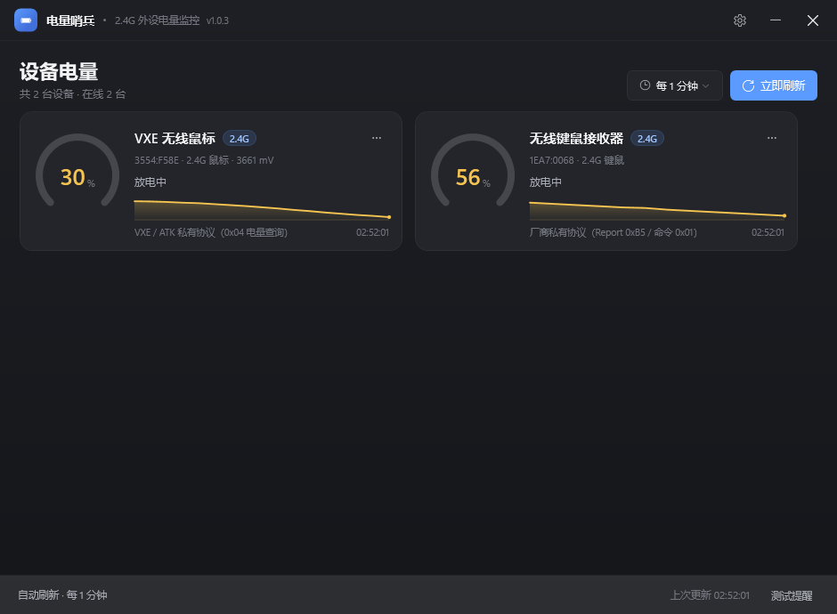

# 电量哨兵（BatterySentinel）

Windows 11 桌面小工具：监控 **2.4G 无线外设**（鼠标 / 键盘 / 耳机接收器，以及蓝牙耳机）的电量，
电量低时在屏幕右上角弹出提醒。

- 原生 **.NET Framework 4.8 + WPF** 实现，单个 exe，**无需安装、无需运行时、无第三方依赖**
- 深色 / 浅色主题（默认跟随 Windows），Win11 圆角与自绘标题栏，Fluent 风格设备卡片
- 托盘常驻，图标本身就是电量条（低电量带红点），右键菜单可刷新 / 静音 / 开机自启 / 退出
- 低电量提醒：轻提示（默认）/ 对话框 / 托盘气泡 / 关闭；两级阈值、冷却时间、静音、单设备静音
- **完全本地**：不联网、不上传、不写日志



## 支持哪些设备

程序对每个物理设备按顺序尝试多种读取策略，命中即用：

| 策略 | 说明 | 状态 |
|---|---|---|
| VXE / ATK / Pulsar 私有协议 | usage page `0xFF02`，17 字节报文，Report ID `0x08`，校验常量 `0x55`；`0x04` 命令返回电量 / 充电标志 / 电压 | 本机实测：`3554:F58E` = 30%，3661 mV |
| 1EA7 键鼠接收器私有协议 | usage page `0xFFB5`，Report ID `0xB5`，命令 `B5 01` 返回电量 | 本机实测：`1EA7:0068` = 56% |
| DARKRIM（杰理方案）耳机 | 65 字节 TLV 帧，CRC16-CCITT-FALSE，TLV `0x01` = 电量 | 移植自参考项目（未在本机复测） |
| ATK / VXE 协议 2 | usage page `0xFF05`，64 字节 Output，请求 `7D 72 02 00 01 07 01` | 参考项目已验证 |
| Endgame Gear | `3367`，Feature `0xA1`，payload `B4`，电量 @16、电压 @17 | 参考项目已验证 |
| VAXEE / ZYGEN | `3057`，Feature `0x0E`，payload `A5 0B 01 01`，电量 5% 步进 | 参考项目已验证 |
| Nordic nRF 接收器 | `1915`，Feature `0x05`，payload `15 00 00 01` | 参考项目已验证 |
| 罗技 HID++ 2.0 | feature `0x1000` / `0x1004` / `0x1001` | 通用实现 |
| 标准 HID 电量字段 | Power Device `0x0006/0x0020`、Digitizer `0x000D/0x003B`、Battery System `0x0085` 等 | 通用实现 |
| 蓝牙 HFP 电量 | 未公开 PnP 属性 `{104EA319-…}, 2`（Hands-Free 节点），并用蓝牙无线电 API 确认当前连接状态 | 只显示当前已连接的设备 |

读不到的外设不会硬编码猜测：界面里的「设备诊断」会列出全部 HID 接口，
命令行 `BatterySentinel.exe --diagnose` 可导出完整报告；也可以在
`%APPDATA%\BatterySentinel\protocols.json` 里补充自定义协议（见下）。

## 使用

直接双击 `BatterySentinel.exe` 即可（首次运行会扫描 3～5 秒）。

- **关闭窗口**只是收进托盘，程序继续在后台按间隔刷新；真正退出请用托盘右键 →「退出」。
- 托盘图标：电量条 + 百分比颜色；低于提醒阈值时右上角出现红点。
- 左键托盘图标 → 打开窗口；右键 → 菜单。
- 设备卡片右上角「⋯」：立即读取 / 复制信息 / 显示详情 / 静音此设备。
- 底部「测试提醒」可以预览弹窗效果。

### 设置项

| 分组 | 说明 |
|---|---|
| 刷新 | 自动刷新开关、刷新间隔（15 秒 ～ 30 分钟，默认 60 秒） |
| 低电量提醒 | 提醒方式、偏低阈值（默认 20%）、严重阈值（默认 10%）、提示音、重复提醒间隔（默认 30 分钟）、一键静音 1 小时 |
| 窗口与启动 | 开机自启（进程内创建「启动」文件夹快捷方式，失败时退回 HKCU Run；任务管理器可见）、启动时最小化、主题、系统强调色 |
| 设备 | 显示蓝牙设备、显示不支持的设备、逐设备重命名 / 静音、设备诊断、打开数据目录 |

提醒逻辑：进入低电量区间弹一次 → 冷却期内不重复 → 降到严重阈值会立刻升级提醒 →
超过冷却期仍处于低电量会再提醒一次 → 充电或回到阈值 +5% 以上后复位。

### 配置文件

| 路径 | 内容 |
|---|---|
| `%APPDATA%\BatterySentinel\settings.json` | 设置、设备自定义名称、静音列表 |
| `%APPDATA%\BatterySentinel\state.json` | 已提醒状态（避免重启后重复弹窗） |
| `%APPDATA%\BatterySentinel\protocols.json` | 用户自定义协议（可选） |
| `%APPDATA%\BatterySentinel\last-error.log` | 仅在崩溃时生成 |

`protocols.json` 是一个数组，字段示例（十六进制可用字符串）：

```json
[
  {
    "name": "我的鼠标",
    "vid": "3554",
    "usagePage": "FF02",
    "reportId": "08",
    "payload": [4],
    "length": 17,
    "levelOffset": 6,
    "waitMs": 150,
    "scale": 1,
    "levelMax": 100,
    "mode": "output"
  }
]
```

## 命令行

```
BatterySentinel.exe                    启动界面 + 托盘
BatterySentinel.exe --minimized        只驻留托盘（开机自启用）
BatterySentinel.exe --once             读一次并打印（可配 --out 文件）
BatterySentinel.exe --diagnose         枚举所有 HID 接口 + 读取结果
BatterySentinel.exe --autostart on|off|status
BatterySentinel.exe --smoke            启动冒烟测试（托盘/窗口/监控是否可创建）
BatterySentinel.exe --selftest         自检：首轮读取后写报告退出
BatterySentinel.exe --alert-test       低电量提醒逻辑的 10 条断言
BatterySentinel.exe --render <目录>     把各页面离屏渲染成 PNG（开发用）
```

控制台模式在没有控制台窗口时不会输出到屏幕，可加 `--out 路径` 写入文件。

## 从源码构建

需要 Windows + 已安装的 .NET Framework 4.8（Win11 自带）。编译器用 dotnet SDK 自带的 Roslyn，
不需要 Visual Studio，也不需要联网还原 NuGet：

```powershell
powershell -ExecutionPolicy Bypass -File build.ps1        # 输出 dist\BatterySentinel\BatterySentinel.exe
python tools\make_icon.py                                  # 需要时重新生成 assets\app.ico
```

源码结构：

```
src\App.cs              入口、单实例、托盘/监控/提醒的装配、命令行与自检
src\Core\Monitor.cs     枚举分组、轮询、历史、低电量判定
src\Core\Settings.cs    设置 / 提醒状态 / JSON 持久化
src\Core\Platform.cs    主题、强调色、开机自启、窗口特效、单实例消息
src\Core\Json.cs        极简 JSON 读写
src\Hid\*.cs            HID 底层：setupapi/hid 枚举、Feature/Output/异步 Input、各厂商协议
src\UI\*.cs             主题、控件（环形电量/迷你曲线）、主窗口、设置页、弹窗、托盘、诊断
tests\HidHarness.cs     HID 读取回归测试（对照真机报文）
```

## 已知限制

- 私有协议是逆向得到的，**只对列出的 VID / usage page 组合生效**；换型号可能要重新标定。
- 鼠标休眠时接收器不会回复电量，界面会显示「上次读数 · 设备无响应」，动一下鼠标即可。
- 若厂商驱动 / 游戏软件独占了设备接口，可能读不到；关闭它们再试。
- 蓝牙设备只显示**当前已连接**的；配对过但没开机的耳机不会出现（它的 HFP 节点和旧电量仍会留在 Windows 设备树里，程序已通过蓝牙无线电 API 过滤）。
- 不支持 Win7/8；Windows 10 理论上可用（未做主测试）。

## 参考与致谢

- 协议与思路来自 [yszyszysz233/2.4G-battery-viewer](https://github.com/yszyszysz233/2.4G-battery-viewer)（MIT）
- VXE / ATK / Pulsar 17 字节协议与 Linux 内核 [hid-pulsar 驱动](https://git.kernel.org/pub/scm/linux/kernel/git/torvalds/linux.git) 的公开实现一致
- 罗技 HID++ 2.0 特性编号参考 Logitech 公开文档与社区实现

本项目仅用于个人学习与自用设备管理，不隶属于任何外设厂商。

## 许可

MIT License，见 [LICENSE](LICENSE)。


版本变更见 [CHANGELOG.md](CHANGELOG.md)。


## 下载

- 最新版本：[Releases](https://github.com/Winn-bmt/battery-sentinel/releases)
- 源码：本仓库（42 个源文件 + 构建脚本 + 截图）


## 代码签名

计划通过 [SignPath Foundation](https://signpath.org/) 为开源项目提供免费 Authenticode 签名。
构建与签名流程（GitHub Actions + 制品配置）见 [SIGNPATH.md](SIGNPATH.md)。

