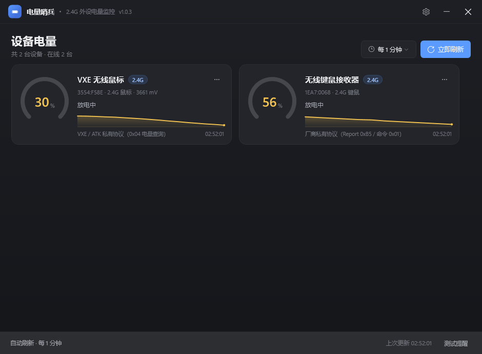
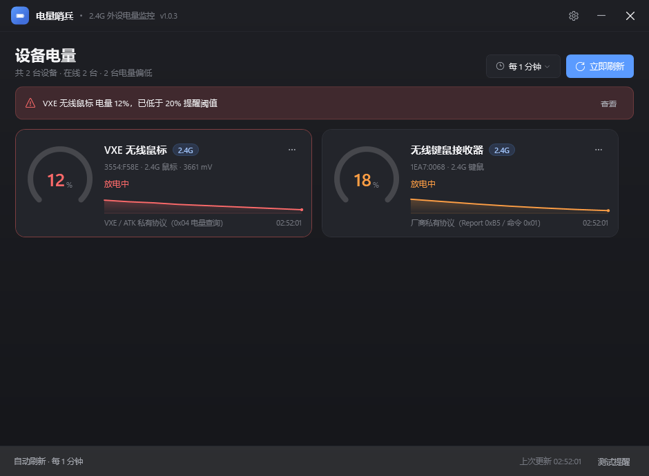
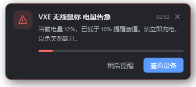

# 电量哨兵 · 使用说明

一个放在 Windows 11 任务栏角落的小工具：随时看 2.4G 鼠标 / 键盘 / 耳机还有多少电，快没电时自动弹窗提醒。

---

## 1. 开始使用

1. 把 2.4G 接收器插到电脑 USB 口（通常就是鼠标 / 键盘自带的那个小 U 盘）。
2. 双击 **`BatterySentinel.exe`**。
3. 等 3～5 秒，窗口里会出现设备卡片，显示电量百分比、状态和读取方式。

不需要安装，不需要联网，也不会往系统里写任何东西（配置在 `%APPDATA%\BatterySentinel`）。

> **建议先把 `BatterySentinel.exe` 复制到一个本地文件夹（例如 `D:\Apps\电量哨兵\`），再从资源管理器双击运行。**
> 直接在压缩包预览窗口、聊天工具里打开时，程序可能运行在受限环境中，导致「打开数据目录」「开机自启」被系统拒绝。

> 第一次运行时 Windows 可能弹出「已保护你的电脑」：点「更多信息」→「仍要运行」。
> 这是 SmartScreen 对未签名程序的正常提示。

## 2. 界面怎么看



- **大圆环**：当前电量。绿色 ≥60%，黄色 30–59%，橙色 15–29%，红色 <15%。
- **标题右侧标签**：`2.4G` 表示 USB 接收器，`蓝牙` 表示蓝牙设备。
- **下方小折线**：最近几次读数的变化趋势。
- **最下面一行**：数据来源（用的哪种协议）和更新时间。
- 卡片右上角 **⋯**：立即读取、复制设备信息、查看详情、静音此设备。
- 电量低于阈值时，顶部会出现一条红色提示条。

电量低的设备卡片会带红色描边，圆环变红。



## 3. 托盘与后台运行

- 点窗口右上角的 **×** 只是**收进托盘**，不会退出；后台仍会按间隔刷新。
- 托盘图标就是电量条：白色外框 + 电量填充；低于阈值时右上角加一个红点。
- **左键单击**托盘图标：打开窗口。
- **右键单击**托盘图标：

```
打开电量哨兵
立即刷新
────────────
✓ 自动刷新
✓ 低电量提醒
────────────
  开机自启
  设置…
────────────
  退出          ← 真正退出程序
```

> 关机 / 注销前不需要手动退出；如果想让程序彻底停止，请用托盘里的「退出」。

## 4. 低电量弹窗

默认是右上角的「轻提示」：从右侧滑入，12 秒后自动消失，鼠标移上去可以点「查看设备」。



- **稍后提醒**：30 分钟内不再打扰（全局静音）。
- **查看设备**：打开主窗口。
- 想换样式：设置 → 低电量提醒 → 提醒方式（轻提示 / 对话框 / 托盘气泡 / 关闭）。
- 想改阈值：设置 → 电量偏低阈值（默认 20%）、严重阈值（默认 10%）。
- 想安静一会儿：设置 →「静音 1 小时」，或在托盘菜单里关掉「低电量提醒」。
- 只想静音某一台设备：设备卡片 ⋯ →「静音此设备提醒」，或设置页的设备列表里操作。

提醒规则（不会刷屏）：

1. 刚跌破偏低阈值 → 提醒一次；
2. 冷却时间内（默认 30 分钟）不重复；
3. 继续掉到严重阈值 → 立刻升级成红色「电量告急」；
4. 超过冷却时间仍然低电量 → 再提醒一次；
5. 开始充电，或电量回到「阈值 +5%」以上 → 重新计数，下次低电量再提醒。

## 5. 设置

| 设置 | 建议 |
|---|---|
| 自动刷新 / 间隔 | 默认 60 秒；笔记本想省电可以改 2～5 分钟 |
| 提醒方式 | 「轻提示」最不打扰；「对话框」必须点「知道了」才消失 |
| 电量偏低阈值 | 默认 20%；无线鼠标一般 10% 左右还能撑一阵，可改 15% |
| 严重阈值 | 默认 10%，会显示红色告警 |
| 提示音 | 关闭后弹窗仍然有，只是不响 |
| 重复提醒间隔 | 默认 30 分钟 |
| 开机自启 | 勾选后创建「启动」文件夹快捷方式（失败时自动用 HKCU Run 注册表项兜底），任务管理器 →「启动」里能看到「电量哨兵」，也可在那里禁用 |
| 启动时最小化 | 登录后只在托盘出现，不弹窗口 |
| 主题 | 跟随系统 / 深色 / 浅色 |
| 使用系统强调色 | 默认关闭（固定天蓝色），因为深色主题的系统强调色常常偏暗 |
| 显示蓝牙设备 | 读取**当前已连接**的蓝牙耳机 HFP 电量（断开后自动消失） |
| 显示不支持的设备 | 排查用：把识别到但读不到电量的外设也列出来 |

设置改完立即生效并自动保存（`%APPDATA%\BatterySentinel\settings.json`）。

## 6. 读不到电量怎么办

先看卡片上的提示文字，常见情况：

| 现象 | 原因 / 处理 |
|---|---|
| 卡片显示「上次读数 · 设备无响应」 | 鼠标 / 键盘休眠了，动一下鼠标或按一个键，再点「立即刷新」 |
| 显示「接口被系统或厂商软件独占」 | 关闭厂商驱动 / 灯效软件后重试 |
| 只显示「未找到可用的电量读取方式」 | 这个型号的私有协议还没收录，点「设备诊断」查看接口；高级用户可提交报告或自定义协议 |
| 完全找不到设备 | 换一个 USB 口（优先主板后置口），确认接收器插好 |
| 点「打开数据目录」或「开机自启」报错 | 程序可能运行在受限环境（压缩包内直接双击、聊天工具里打开、沙箱等）。把 exe 复制到本地文件夹，从资源管理器双击运行后再试；管理员身份运行时打开文件夹会自动改走 Shell 接口 |

**设备诊断**（设置 → 设备 → 设备诊断）会列出电脑上所有 HID 接口和 Feature 报文，
选中某个接口点「读取选中接口」即可看到原始数据，方便判断问题。

命令行导出完整报告：

```powershell
BatterySentinel.exe --diagnose --out "%USERPROFILE%\Desktop\hid-report.txt"
```

## 7. 常见问题

**Q：为什么蓝牙耳机没连上就不显示了？**
A：这是有意的。Windows 会把上次连接的电量缓存在设备节点里，程序用蓝牙无线电 API 确认「此刻真的连着」才显示，避免把已关机的耳机当成在线设备。

**Q：蓝牙耳机连着但没显示电量？**
A：说明耳机没有通过 HFP 上报电量（或还没上报过），常见于部分 TWS 耳机；换用厂商 App 查看即可。

**Q：会不会在后台一直占 CPU？**
A：不会。默认每 60 秒读一次，每次几十毫秒；空闲时线程在等待，几乎为 0。

**Q：会上传我的设备信息吗？**
A：不会。程序没有任何网络代码，设备名 / 序列号只在内存里用。

**Q：怎么卸载？**
A：托盘右键退出 → 删除 exe 所在文件夹 → （可选）删除 `%APPDATA%\BatterySentinel` →
设置里关掉「开机自启」（或删除「启动」文件夹里的「电量哨兵.lnk」）。

**Q：想开机就用，但不想看到窗口？**
A：设置 → 打开「开机自启」和「启动时最小化」。

## 8. 命令行（进阶）

```
BatterySentinel.exe --once                    读一次并打印结果
BatterySentinel.exe --diagnose                枚举全部 HID 接口 + 读取结果
BatterySentinel.exe --autostart on|off|status 开机自启开关 / 查看状态
BatterySentinel.exe --minimized               只驻留托盘
BatterySentinel.exe --selftest                自检并输出报告
```

在没有控制台窗口的情况下（例如从资源管理器启动），加 `--out 文件路径` 把内容写到文件。

---

版本 1.0.3 · 协议参考 [2.4G-battery-viewer](https://github.com/yszyszysz233/2.4G-battery-viewer)（MIT）
